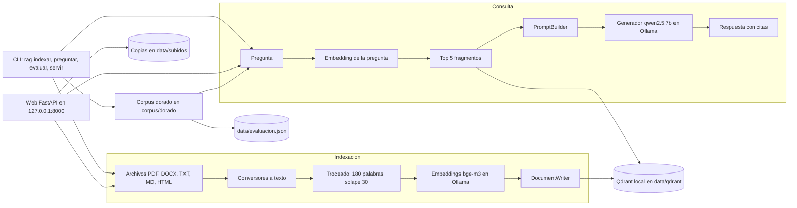

# RAG personal sobre documentos locales

Indexa tus documentos (PDF, DOCX, TXT, MD, HTML) y haz preguntas en lenguaje natural. Las respuestas citan el fragmento de origen. Todo corre en tu equipo: Haystack, Qdrant en modo local y Ollama.

Diseño y decisiones: [docs/design/ADR-001-diseno-minimalista.md](docs/design/ADR-001-diseno-minimalista.md).

## Requisitos

- Python 3.10 o superior.
- [Ollama](https://ollama.com) instalado y en marcha.

```bash
ollama pull qwen2.5:7b
```

```bash
ollama pull bge-m3
```

## Instalación

```bash
python3 -m venv .venv
```

```bash
.venv/bin/python -m pip install -e ".[dev]"
```

## Uso

Indexar archivos o carpetas completas. Reindexar un archivo reemplaza su versión anterior.

```bash
.venv/bin/rag indexar corpus/documentos
```

Preguntar:

```bash
.venv/bin/rag preguntar "¿Cuántos días por semana puede aplicarse el teletrabajo?"
```

Medir el sistema contra el corpus dorado (preguntas con respuesta y fuente conocidas):

```bash
.venv/bin/rag evaluar
```

El resultado completo queda en `data/evaluacion.json`.

## Interfaz web

Arranca un servidor local y abre la página para subir documentos y hacer preguntas:

```bash
.venv/bin/rag servir
```

Abre http://localhost:8000. El servidor escucha solo en 127.0.0.1 y la página no tiene contraseña: no lo expongas a otras redes.

Guía didáctica del proyecto en Word: [docs/guia-didactica/guia-rag-personal.docx](docs/guia-didactica/guia-rag-personal.docx).

## Licencia

MIT. Ver [LICENSE](LICENSE).

## Arquitectura



## Estructura

```text
src/rag_normativo/
  motor.py      indexación, recuperación y generación
  evaluar.py    métricas sobre el corpus dorado
  cli.py        comandos indexar, preguntar y evaluar
corpus/
  documentos/   documentos ficticios de prueba (corpus dorado)
  distractores/ 39 documentos ficticios de distracción (versiones antiguas, borradores y temas ajenos)
  dorado/       preguntas.jsonl: pregunta, respuesta clave y fuente
tests/          pruebas unitarias y de entorno
data/           índice Qdrant y reportes (generado, no se versiona)
```

## Corpus dorado

`corpus/dorado/preguntas.jsonl` contiene 30 preguntas: 24 con respuesta en los documentos y 6 sin respuesta. Los documentos son ficticios y las respuestas las preparé yo, así que la evaluación mide que el pipeline funciona. No mide que una respuesta jurídica sea correcta.

Para añadir casos, agrega una línea por pregunta con los campos `id`, `pregunta`, `respuesta_clave` (lista de textos que deben aparecer en la respuesta), `documento` y `respondible`.

## Prueba de recuperación con distractores

Indexa el corpus dorado junto con los distractores y mide la evaluación:

```bash
.venv/bin/rag indexar corpus/documentos corpus/distractores
```

```bash
.venv/bin/rag evaluar
```

Con distractores, el documento correcto queda en primer lugar en menos casos que sin ellos. Ver la métrica `documento_correcto_en_primer_lugar` en el resumen.

## Pruebas

```bash
.venv/bin/python -m pytest -q
```

```bash
.venv/bin/ruff check .
```

## Autoría

Alejandro Moraga